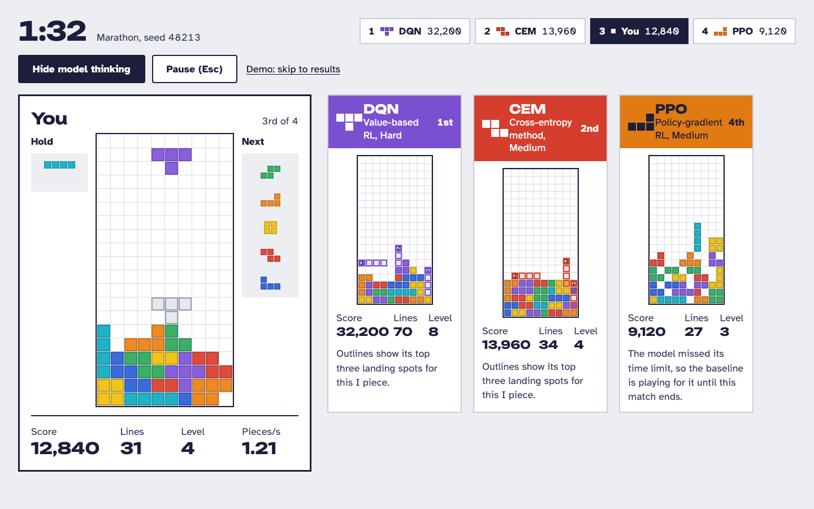
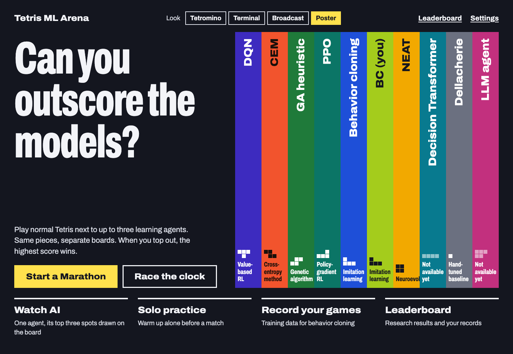
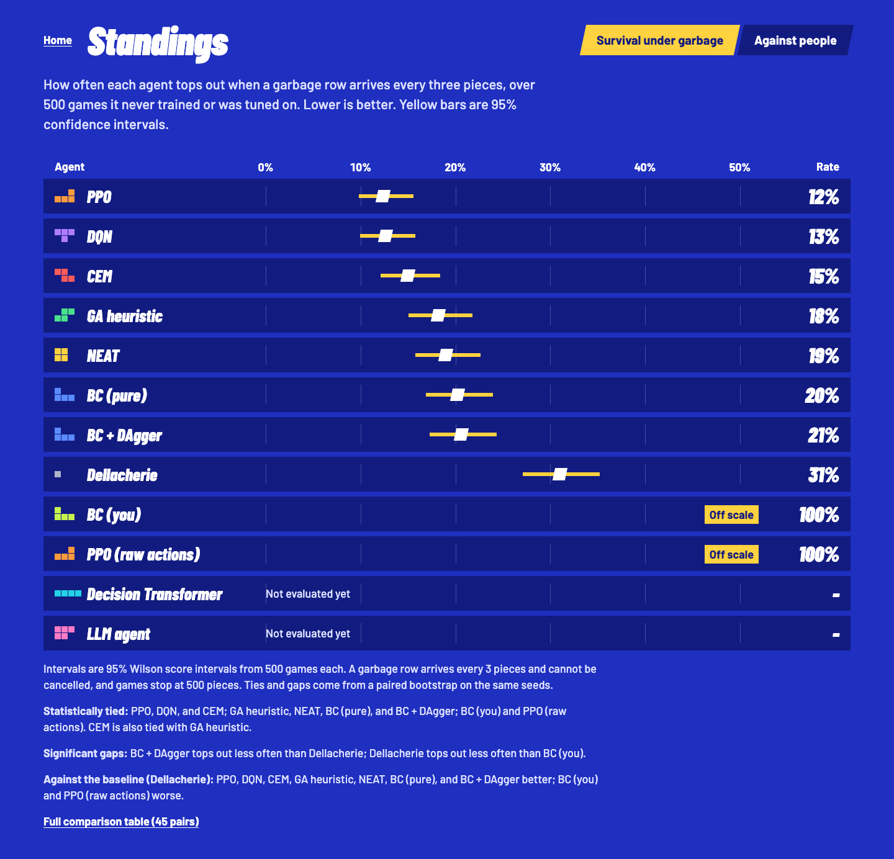
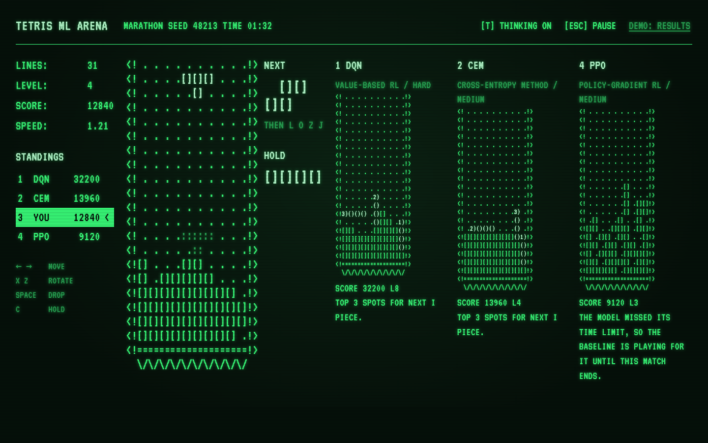
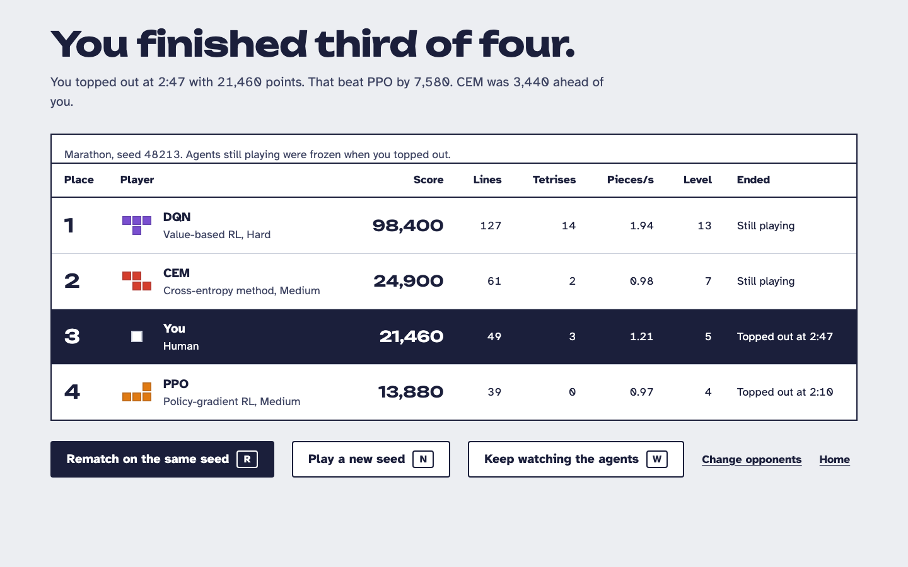

# Tetris ML Arena

Play Tetris against machine learning agents in real time, on the desktop or
in the browser. The agents range from a hand-tuned heuristic and a genetic
algorithm to DQN, PPO, imitation learning, NEAT, a Decision Transformer and
an optional LLM. They all play the same deterministic engine, and are
compared on held-out games under one evaluation protocol.



| | |
|---|---|
|  |  |
|  |  |

## Quick start

Requires Python 3.11 or 3.12 (3.12 recommended; some dependencies lack wheels
for newer versions). Playing uses only the CPU. Node is needed only to work
on the web frontend; the built frontend is committed.

```bash
python3.12 -m venv .venv
source .venv/bin/activate
pip install -e ".[dev,web]"
```

```bash
python -m tetris             # desktop app (Pygame)
python -m tetris.web         # web app at http://127.0.0.1:8765/, opens the browser
python -m tetris.web --demo  # demo mode for a projector: fixed look, opponents and seed
```

The GA, CEM, NEAT and Dellacherie agents work out of the box. The deep
learning agents need trained checkpoints, which are not in git: train them,
or point the apps at an existing `checkpoints/` directory. Controls, modes,
training, evaluation and tests are in [docs/usage.md](docs/usage.md).

## Results

Garbage setting: one garbage row every 3 pieces, games capped at 500
pieces, 500 held-out seeds per agent. Fitness per game is pieces / cap plus
0.25 × score per piece / 1000, so survival dominates and score per piece
breaks ties. Agents that share a letter in the group column are not
significantly different (paired bootstrap, 95%).

| Rank | Agent | Fitness | Pieces survived | Top-out rate [95% Wilson] | Group |
|---|---|---|---|---|---|
| 1 | DQN (afterstates) | 1.345 | 475.6 | 0.13 [0.10, 0.16] | a |
| 2 | PPO (afterstates) | 1.339 | 472.8 | 0.12 [0.10, 0.16] | ab |
| 3 | Cross-entropy method | 1.318 | 468.7 | 0.15 [0.12, 0.18] | abc |
| 4 | Decision Transformer | 1.309 | 466.0 | 0.16 [0.13, 0.19] | bcd |
| 5 | Imitation (pure BC) | 1.296 | 459.7 | 0.20 [0.17, 0.24] | cd |
| 6 | GA heuristic | 1.289 | 457.9 | 0.18 [0.15, 0.22] | cd |
| 7 | NEAT | 1.280 | 456.1 | 0.19 [0.16, 0.23] | d |
| 8 | Imitation (BC + DAgger) | 1.280 | 453.9 | 0.21 [0.17, 0.24] | d |
| 9 | Dellacherie (baseline) | 1.196 | 427.5 | 0.31 [0.27, 0.35] | e |
| 10 | BC (you), from 7 recorded human games | 0.147 | 56.5 | 1.00 [0.99, 1.00] | f |
| 11 | PPO (raw actions) | 0.103 | 44.4 | 1.00 [0.99, 1.00] | g |

The LLM agent is evaluated separately, with a 100-piece cap on 20 seeds,
where the GA survives 99.3 pieces on average: qwen3:8b with board features
survives 26.8 pieces, llama3.1:8b 23.9, and qwen3:8b without features 10.6.

## Key findings

- **The top eight agents are statistically tied in sequence.** Every
  adjacent pair from DQN to BC + DAgger has a fitness interval that includes
  0, and the whole spread is 0.065. They share one action space (a placement
  per piece, chosen by scoring afterstates), and the ceiling appears to come
  from that shared setup rather than the learning method. Raw-action PPO,
  which has to learn placements from scratch, is far below.
- **The Decision Transformer's target return is not a difficulty knob.**
  Asking v1 for a return of 0.2 still plays at 1.32. A v2 trained on data
  whose skill the board shows did not fix it (rank correlation +0.00) and
  played worse held out, so v1 stays and the app plays it at its default
  target.
- **DAgger added nothing when BC already agreed 95% with the teacher.** Two
  rounds raised agreement to 96.3% but not play.
- **Selection on 30 seeds overestimates.** Picking the best of many noisy
  checkpoints picks lucky ones: NEAT dropped 0.115 from selection to held
  out, the others 0.04 to 0.07.
- **Small local LLMs cannot play this game.** They answer every move but top
  out in every game; the board features add 16.2 pieces for qwen3:8b.
- **Two training bugs were diagnosed and fixed:** DQN value overestimation,
  and wrong convolution gradients on Apple MPS at large batches, which kept
  the first PPO run from training. Every GPU run now starts with a CPU
  gradient check.

The full write-up, with the protocol, every result and its confidence
interval, the threats to validity and how to reproduce each result, is
[reports/FINAL_REPORT.md](reports/FINAL_REPORT.md). The other reports are
indexed in [reports/README.md](reports/README.md).

## Repository layout

```
tetris/
  engine/        headless rules: SRS, 7-bag, hold, gravity, lock delay, scoring, garbage
  env/           Gymnasium env, afterstate enumeration, features, reward shaping
  agents/        agent interface, registry, planner, difficulty, evaluation, checkpoint checks
    heuristic_ga/ cem/ dqn/ ppo/ imitation/ neuroevolution/ decision_transformer/ llm/
  rl/            shared networks, vectorized env, selection, training loop helpers
  match/         MatchController (real time or lockstep), rules, agent driver,
                 worker processes, lobby, DAS/ARR, feed, history, recording
  ui/pygame/     the desktop app (the only package that imports Pygame)
  web/           FastAPI server, WebSocket protocol, committed frontend build (static/)
web/             React + TypeScript frontend source, four looks, Vitest and Playwright tests
scripts/         train/, eval/, analysis/, queue/, tools/ (see scripts/README.md)
reports/         FINAL_REPORT.md and every result, indexed in reports/README.md
docs/            usage, architecture, demo checklist, web UI design, screenshots
configs/         env defaults, demo.yaml
logs/            queue logs of the runs behind the reports
checkpoints/     trained agents (only the GA, CEM and NEAT weights are in git)
tests/
```

The code structure and design rules are in
[docs/architecture.md](docs/architecture.md).

## License

MIT, see [LICENSE](LICENSE). The bundled fonts are under the SIL Open Font
License (`OFL.txt` next to each font).
