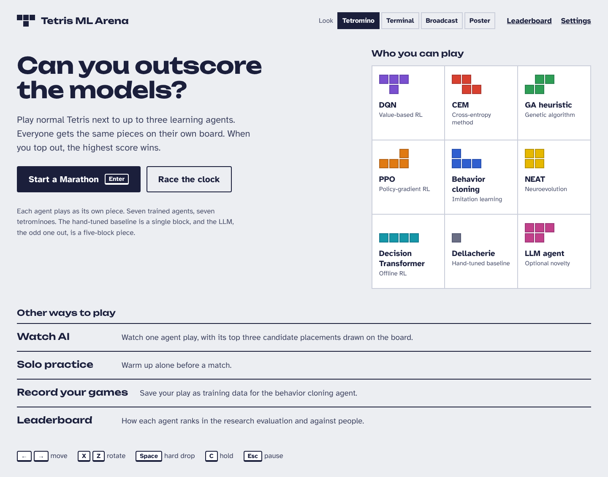
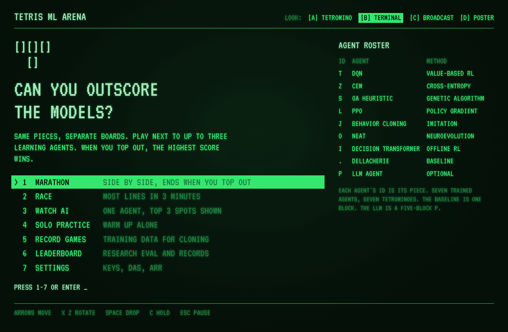
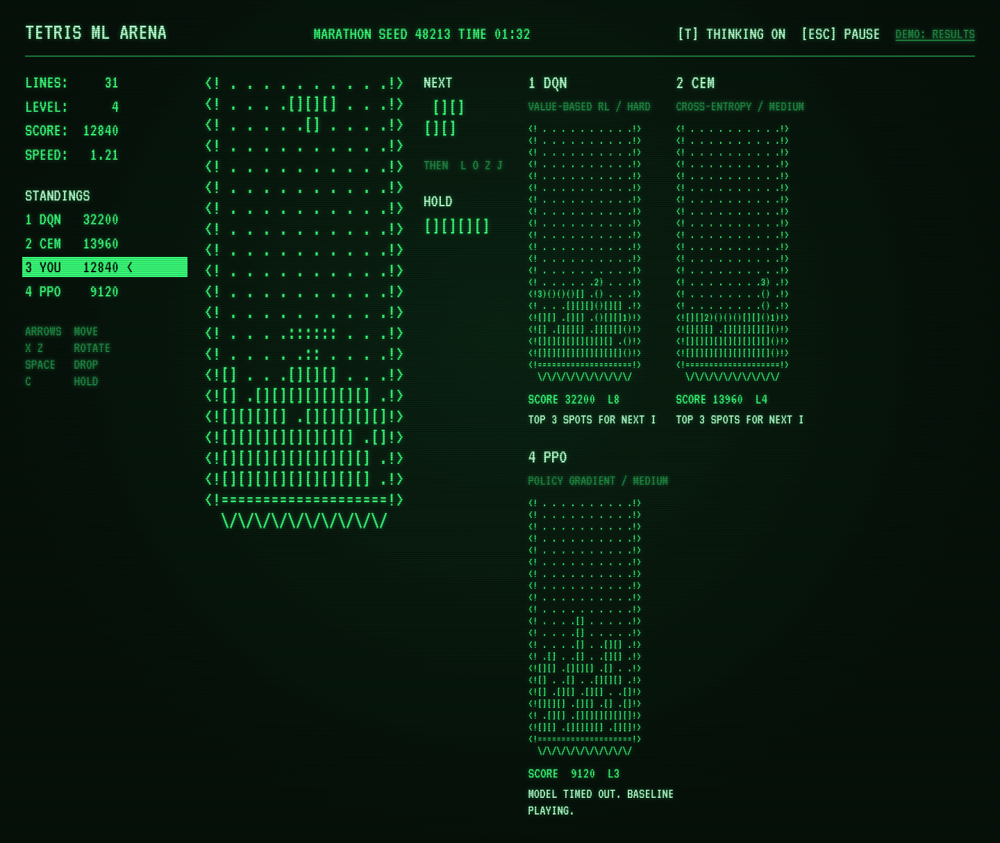
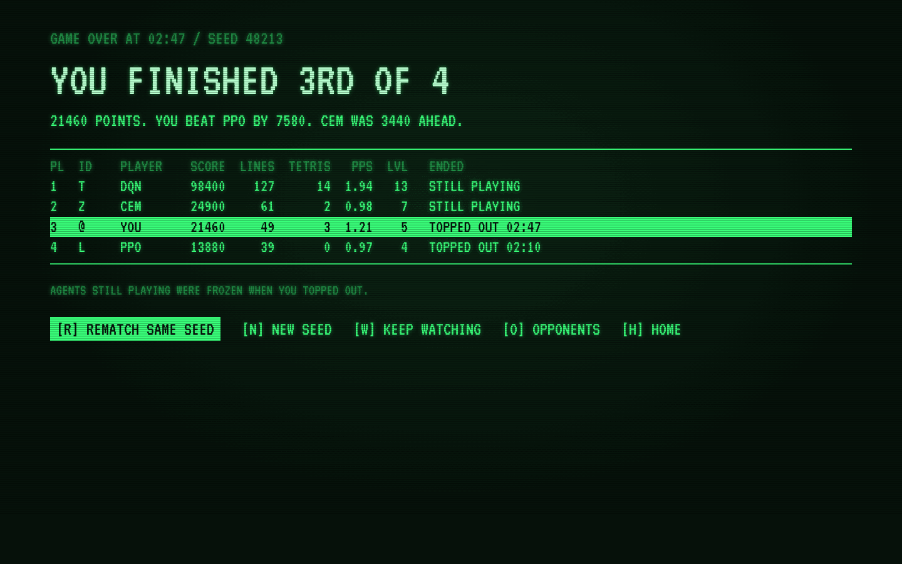
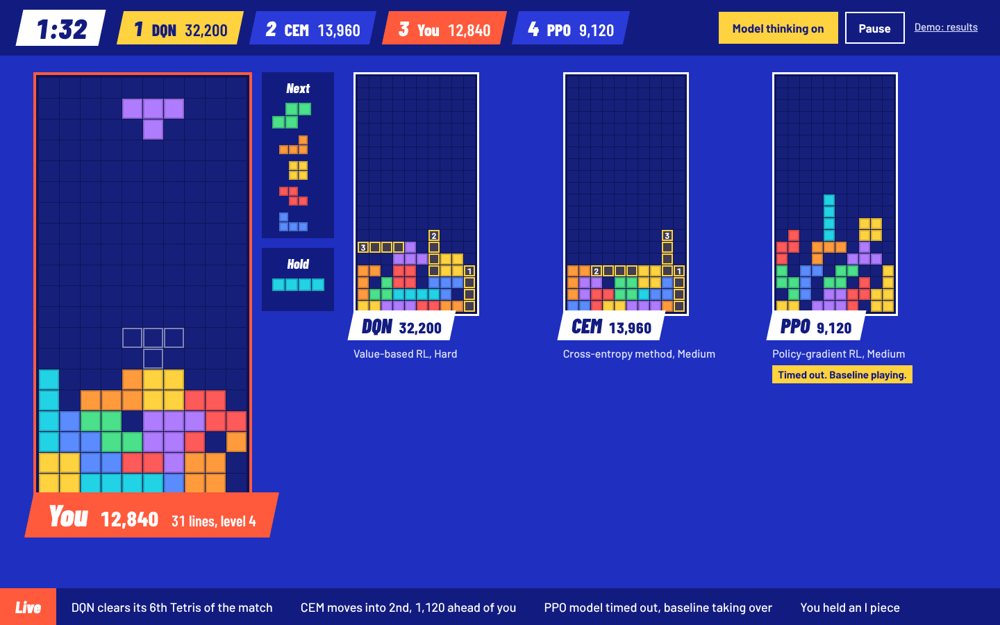
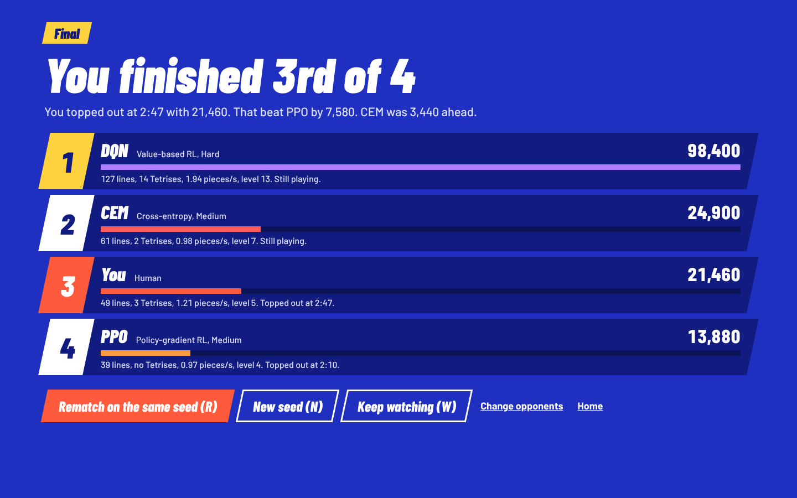
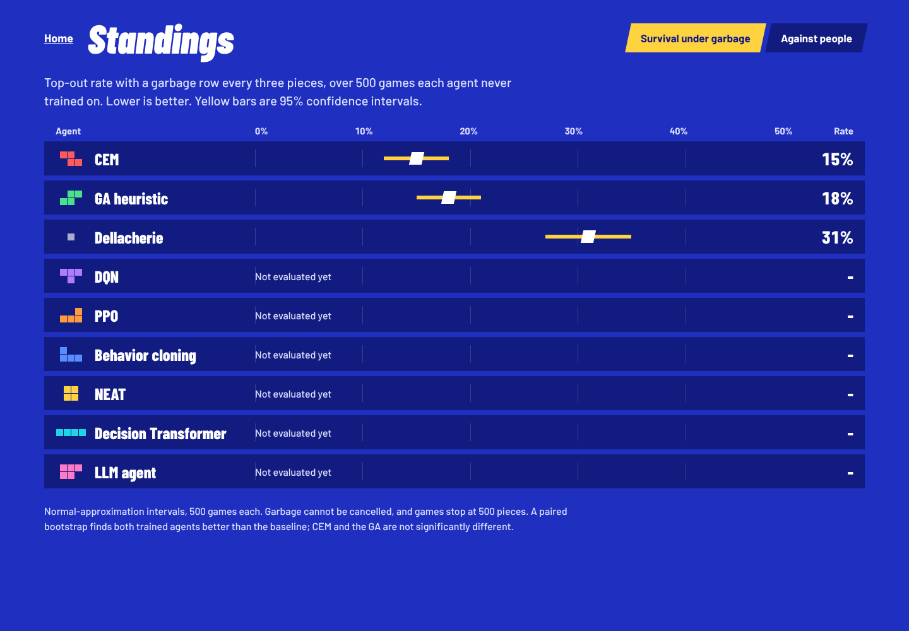
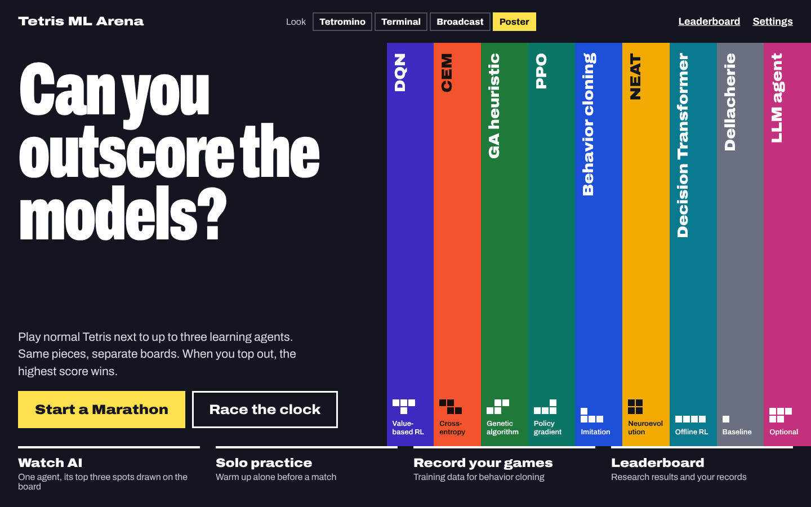
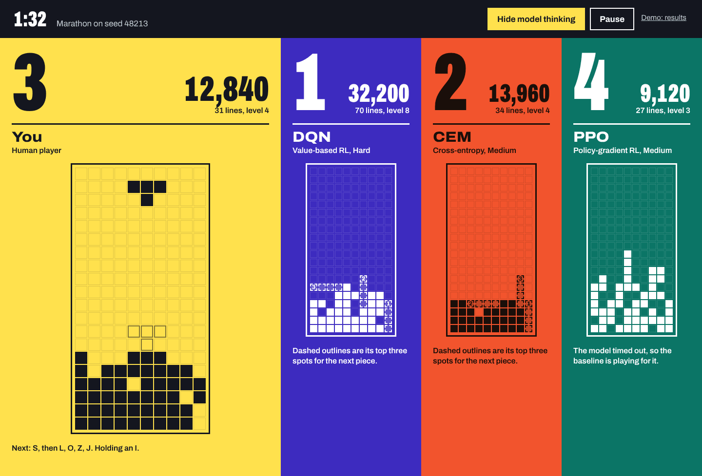

# Phase 8: Web UI with four selectable looks

Phases 1 to 7 are done: engine, env, all agents, evaluation harness, Marathon and Race modes, and the Pygame app. Phase 8 adds a browser UI served by a local Python server. It will be demoed live in a PhD class on a projector, so readability at a distance and a reliable offline launch matter more than anything else.

The `mockups/` folder next to this file has 20 screenshots: 4 looks (A Tetromino, B Terminal, C Broadcast, D Poster) x 5 screens (Home, Choose opponents, Marathon match, Results, Leaderboard), rendered at 1440px wide. Open every image before planning. Treat the screenshots as the visual target and this prompt as the spec. Where they disagree, follow this prompt and tell me. All numbers in the mockups are sample match state, except the CEM, GA and Dellacherie leaderboard values, which come from the real Phase 3 evaluation.

Before writing code, read this whole prompt and reply with a short plan: directory layout, the WebSocket message schema, how themes are structured, and anything that conflicts with the existing code or seems impractical. Wait for my approval. Then work through sub-phases 8a to 8d and stop after each one with a summary, how to run it, and test results.

## Mockups

Each look has five screens. The look switcher on every Home screen links between looks.

### A. Tetromino

**A1. Home**

**A2. Choose opponents**

**A3. Marathon match**

**A4. Results**

**A5. Leaderboard**

### B. Terminal 1984

**B1. Home**

**B2. Choose opponents**

**B3. Marathon match**

**B4. Results**

**B5. Leaderboard**

### C. Broadcast

**C1. Home**

**C2. Choose opponents**

**C3. Marathon match**

**C4. Results**

**C5. Leaderboard**

### D. Color-field poster

**D1. Home**

**D2. Choose opponents**

**D3. Marathon match**

**D4. Results**

**D5. Leaderboard**

## Architecture

- **Server:** FastAPI + uvicorn in `tetris/web/`. It wraps the existing `MatchController` and agent worker pool. Game logic stays server-side and authoritative. Do not reimplement any game rules in the browser.
- **Transport:** one WebSocket per client.
  - The client sends input events (key down and key up with timestamps). DAS, ARR and soft drop stay in the existing Python input layer.
  - The server streams snapshots at 60 Hz. Use a compact encoding: a board is a 200-character string, plus the active piece, ghost, hold, next queue and stats.
  - Measure and report message size and input-to-render latency (p50 and p99) on localhost.
- **REST endpoints:** for agents and their checkpoints, settings, leaderboard data, match history, and starting or ending a match.
- **Frontend:** TypeScript + Vite + React, built into static files that FastAPI serves.
  - Draw boards on `<canvas>` for 60 fps with four boards on screen.
  - Build menus, panels, tables and charts in DOM, so they get real buttons, links, focus states and screen reader support.
- **Keep the Pygame app working.** It is the fallback if the browser path fails during the demo.

## Additions to the match layer

1. **Event feed.** `MatchController` emits typed events: line clear (with count), Tetris, back-to-back, lead change, top-out, agent fallback to baseline (with reason), and match end. They go out over the WebSocket. Broadcast's ticker and the results screen use them.
2. **Model thinking.** Each agent worker returns its top 3 candidate placements with ranks along with its chosen placement.
   - Value-based and heuristic agents rank by value.
   - PPO and behavior cloning rank by policy probability.
   - The Decision Transformer ranks by action logits.
   - The LLM agent and any agent in fallback return none.
   - Include the candidates in the snapshot so the client can draw them as numbered outlines. A "Show model thinking" toggle hides them, and it defaults to on.
3. **History.** Store each Marathon result (seed, opponents and difficulties, every player's final stats) in a local JSON or SQLite file. The opponent and leaderboard screens show "Your record" per agent and difficulty. A win means the human's score beat that agent's score.

## Theme system

- One set of screens and components. A theme supplies:
  - design tokens: colors, fonts, spacing, borders and radii;
  - a board renderer (canvas drawing function);
  - layout variants where the mockups differ structurally.
- A theme registry with ids `tetromino`, `terminal`, `broadcast` and `poster`. Adding a theme should mean adding one folder.
- The look switcher appears on every Home screen and in Settings. Persist the choice in localStorage and in the server settings file. Switching takes effect immediately, including mid-match.
- **Self-host all fonts** as woff2 files in the repo. All four families are under the SIL Open Font License; include the license files. No CDN or Google Fonts requests at runtime.

### Agent identity (shared by every theme)

Each agent is a piece. Shapes: T, Z, S, L, J and O are the standard tetrominoes; I is four in a row; "mono" is a single block; "P" is the P pentomino (XXX over XX.).

| Agent | Piece | A color | C color | D field / text | B letter |
|---|---|---|---|---|---|
| DQN | T | #7A4FD0 | #B07CFF | #3D2BBF / #FFFFFF | T |
| CEM | Z | #D8402F | #FF5A5A | #F2542D / #1A0F0A | Z |
| GA heuristic | S | #2E9E55 | #4BE08A | #1F7A3A / #FFFFFF | S |
| PPO | L | #E07A12 | #FF9B3D | #0B7566 / #FFFFFF | L |
| Behavior cloning | J | #2F5FD0 | #5B8CFF | #1E4FD8 / #FFFFFF | J |
| NEAT | O | #E6B800 | #FFD23F | #F2A900 / #14161F | O |
| Decision Transformer | I | #1597A8 | #22D3E6 | #087A8F / #FFFFFF | I |
| Dellacherie (baseline) | mono | #6B7080 | #AEB4C8 | #6B7080 / #FFFFFF | . |
| LLM agent (optional) | P | #C2408A | #FF7AC6 | #C2307E / #FFFFFF | P |
| Human | none | ink #1B1F3B | coral #FF5A3C | #FFE14D / #14161F | @ |

Define this once in a shared module, not per theme.

### A. Tetromino

- **Colors:** background #ECEEF2; ink #1B1F3B; secondary text #3E4462 and #4D5370; panels #FFFFFF; borders #C9CEDA; board gaps #D6DAE3.
- **Board pieces:** I #1FB3C4, O #F2C318, T #8A5FDB, S #3BB065, Z #E04B39, J #3A6BDB, L #EE8A22. Draw flat fills with a 2px inner ink border at 20% opacity. Empty cells are white.
- **Fonts:** Unbounded 600/700 for headings and big numbers; Atkinson Hyperlegible 400/700 for everything else, with tabular figures.
- **Shape:** square panels and 4px radius buttons. The human board has a 3px ink border. Agent card headers are filled with the agent color, with white text (ink text on PPO's orange).
- **Model thinking:** candidate outlines drawn in the agent's color with a 15% fill, and the rank number in the first cell.
- **Leaderboard:** a confidence-interval chart. Each row has a dot for the estimate and a bar for the 95% interval, in the agent color, on a 0 to 50% scale.

### B. Terminal 1984 (homage to the Elektronika 60 original)

- **Colors:** background #06110A with a radial glow to #0C2414; text #39FF7A; bright #B8FFD0; dim #1F8A45; text glow `0 0 6px rgba(57,255,122,0.45)`. A scanline overlay is a repeating 1px dark line every 3px.
- **Font:** VT323 everywhere.
- **Boards are text:**
  - a filled cell is `[]` and an empty cell is ` .`;
  - the ghost is `::`;
  - walls are `<!` and `!>`, with a `<!====...!>` floor and a `\/\/\/...` base row;
  - model-thinking candidates are `()`, with the first cell showing the rank as `1)`, `2)` or `3)`.
  The renderer draws characters, not colored cells.
- **Home** is a numbered keyboard menu: keys 1 to 7 select, Enter starts Marathon, and the selected row is shown in reverse video.
- **Results and Leaderboard** are fixed-width tables. The confidence-interval chart is ASCII: `.` for the track, `[` and `]` for the interval ends, `=` inside it, and `*` for the estimate.
- The blinking cursor stops when `prefers-reduced-motion` is set.

### C. Broadcast (esports stream)

- **Colors:** background #1F2FBF; deep panels #121C80; board wells #16207A and #0C1458; text #FFFFFF and #DCE1FF; coral #FF5A3C for the human; yellow #FFD23F for the leader, the active toggle and the candidate outlines.
- **Board pieces:** I #22D3E6, O #FFD23F, T #B07CFF, S #4BE08A, Z #FF5A5A, J #5B8CFF, L #FF9B3D.
- **Fonts:** Barlow Condensed (italic 800/900) for names, scores and headings; Barlow 500/700 for body text.
- **Shape language:** plates, tabs and buttons are skewed with `skewX(-12deg)`, and their contents are counter-skewed so the text stays upright.
- **Match screen:**
  - a score bar across the top, sorted by rank, with the leader's plate in yellow and the human's in coral;
  - a name banner overlapping the bottom of each board;
  - a "Live" ticker along the bottom, fed by the event feed. Write ticker lines in plain words ("CEM moves into 2nd, 1,120 ahead of you").
- **Home** shows a "Survival eval" ticker built from the leaderboard data.

### D. Color-field poster

- **Colors:** background #14161F; each player is a full-height column filled with their D field color.
- **Font:** Archivo (variable width). Use width 62% for huge numerals (ranks at about 168px, scores at 52 to 72px) and 112% for names.
- **Boards are one color:** filled cells in the column's text color; empty cells as faint grid lines in that color at 14%; the ghost as an outline at 55%; candidates as dashed outlines.
- **Match and Results:** the human's column is yellow and twice as wide as the others.
- **Home:** nine vertical agent stripes with the names rotated.
- **Leaderboard:** one horizontal band per agent with a large top-out percentage. Agents not evaluated yet get grey bands with a strip of their color on the left edge.

## Screens (all four themes)

1. **Home:** headline, two start buttons (Marathon, Race), the agent lineup, other modes (Watch AI, Solo practice, Record your games, Leaderboard), the look switcher and a controls legend.
2. **Choose opponents:**
   - a Marathon/Race toggle;
   - an agent list showing piece, name, family, one-line description and "Your record";
   - 3 slots, each with a difficulty selector (Easy, Medium, Hard, Unlimited) and a one-line description of that difficulty. Duplicate agents are allowed.
   - List only agents that have checkpoints. Remember the last selection.
   - The start button says what will happen ("Start Marathon against 3 agents").
3. **Match:**
   - timer and live standings;
   - the human board with hold, a 5-piece next queue and stats (score, lines, level, pieces per second);
   - one board per agent with name, family, difficulty, place, score, lines, level and a status line;
   - the model-thinking toggle, and Pause (Esc).
   - When an agent falls back to the baseline, say so in plain words on its board.
   - Race mode uses the same screen with its timer and win condition.
4. **Results:**
   - a plain-sentence headline ("You finished third of four.") and a one-line summary of the score gaps;
   - a table of place, player, score, lines, Tetrises, pieces per second, level and how each game ended;
   - actions: Rematch on the same seed (R), New seed (N), Keep watching the agents (W), Change opponents, Home.
5. **Leaderboard:**
   - **Survival tab:** top-out rate with 95% normal-approximation intervals from `reports/`, plus pieces survived and score per piece. Explain the method in a short note that includes the paired bootstrap result. Agents not yet evaluated show "Not evaluated yet".
   - **Against people tab:** the Marathon evaluation per difficulty, plus your record against each agent.
6. **Not mocked up; build them in each theme using the same components:** Watch AI (one agent, with the top-3 overlay always available), Solo practice, Record your games, and Settings (look, key rebinding, DAS, ARR, soft drop speed, ghost piece).

Never invent numbers in the UI. Any value not yet computed shows as pending.

## Quality bar

- **Projector:**
  - Test at 1920x1080 and 1280x720.
  - Body text at least 18px. Scores and timers large enough to read from the back of a classroom.
  - All text meets 4.5:1 contrast, or 3:1 for 24px and larger.
- **Accessibility:**
  - Full keyboard navigation with a visible focus ring.
  - Real `<button>` and `<a>` elements, and `aria-pressed` or `aria-selected` on toggles and tabs.
  - Boards have `role="img"` with a label.
  - Respect `prefers-reduced-motion`.
- **Performance:** 60 fps with the human and three agents on Unlimited. Report p50 and p99 frame time in the browser, and input-to-render latency.
- **Resilience:**
  - If the WebSocket drops, pause the match, show a plain banner ("Connection lost. Reconnecting...") and resume on reconnect.
  - Agent fallbacks show on the board but never stop the match.
- **No emojis** anywhere in code, UI copy or docs.

## Demo mode and launch

- `python -m tetris.web` starts the server, builds the frontend if needed, and opens the browser. It must work with no internet connection.
- `--demo` flag:
  - preselects opponents (CEM Medium, DQN Hard, PPO Medium) and a fixed seed;
  - starts on the Tetromino look;
  - lets F9 skip to the results screen and F10 cycle through the four looks.
- Write `docs/demo_checklist.md` with the pre-class steps: run once while online to cache everything, check the projector resolution, test fullscreen (F11), and know the Pygame fallback command.

## Tests

- **Server:** API endpoint tests, a WebSocket protocol test (connect, start a match, send inputs, receive snapshots and events, reconnect), and a schema test that every snapshot validates.
- **Logic:** tests that the top-3 candidates are legal placements and are ranked in order for each agent type, and tests for the event feed (Tetris, lead change, fallback).
- **Frontend:** Playwright smoke tests that load every screen in every theme at 1280x720 and save screenshots to `reports/ui/`, plus a keyboard-only run through Home, Choose opponents, Match and Results.
- Everything from Phases 1 to 7 must still pass.

## Sub-phases (stop after each)

- **8a:** server, WebSocket protocol, event feed, model-thinking candidates and history storage, with tests. Include a bare HTML page that proves the full loop works.
- **8b:** theme system, shared components, and the Tetromino look across all screens, including the screens that were not mocked up.
- **8c:** the Terminal, Broadcast and Poster looks.
- **8d:** demo mode, the offline launch, the performance report, Playwright screenshots, the accessibility pass and `docs/demo_checklist.md`.

If any requirement conflicts with the existing code or another requirement, flag it with a proposed alternative instead of silently changing it.
