# Web UI design: four selectable looks

The design brief the browser UI was built from. The UI was made for a live
demo in a PhD class on a projector, so readability at a distance and a
reliable offline launch mattered more than anything else. The build follows
this brief except where "What changed in the build" says otherwise; the code
structure is in [../../architecture.md](../../architecture.md).

The `mockups/` folder has 20 mockups: four looks (A Tetromino, B Terminal,
C Broadcast, D Poster) x five screens (Home, Choose opponents, Marathon
match, Results, Leaderboard), rendered at 1440px wide. They were the visual
target, and this text the spec. All numbers in them are sample match state,
except the CEM, GA and Dellacherie leaderboard values, which came from the
real evaluation at the time.

## Mockups

| Screen | A. Tetromino | B. Terminal 1984 | C. Broadcast | D. Color-field poster |
|---|---|---|---|---|
| Home |  |  | 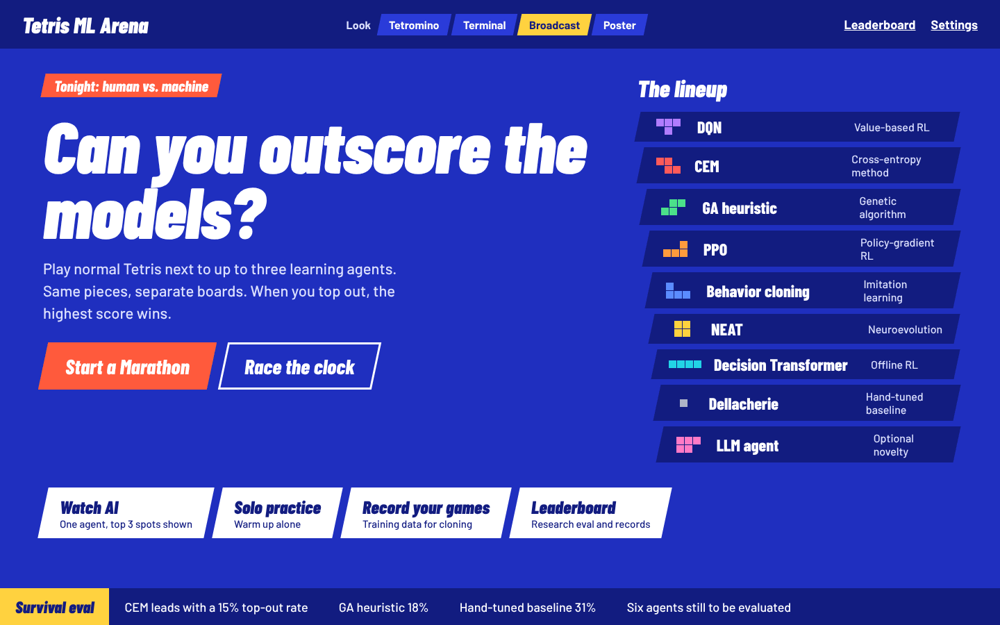 |  |
| Choose opponents | 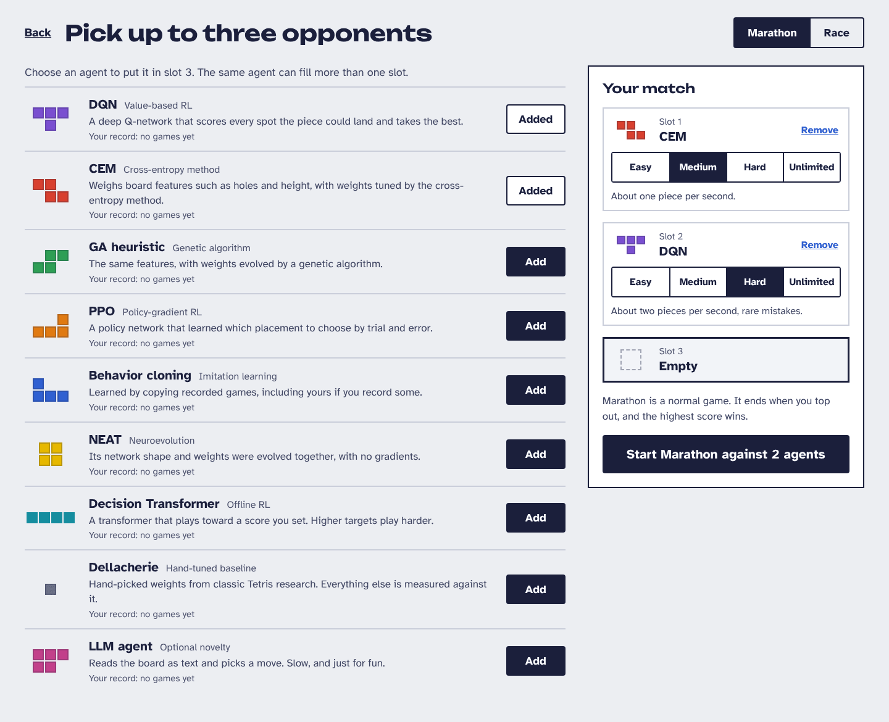 | 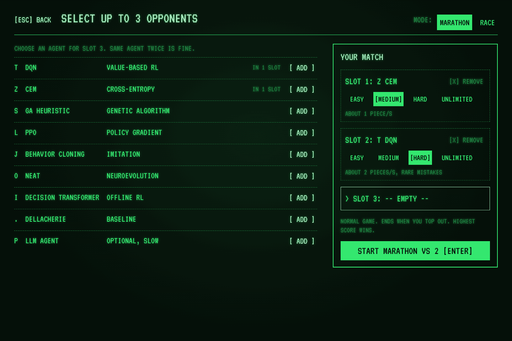 | 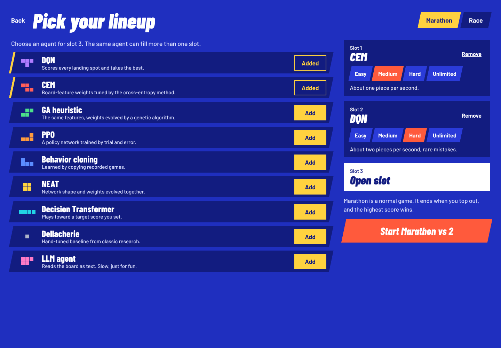 | 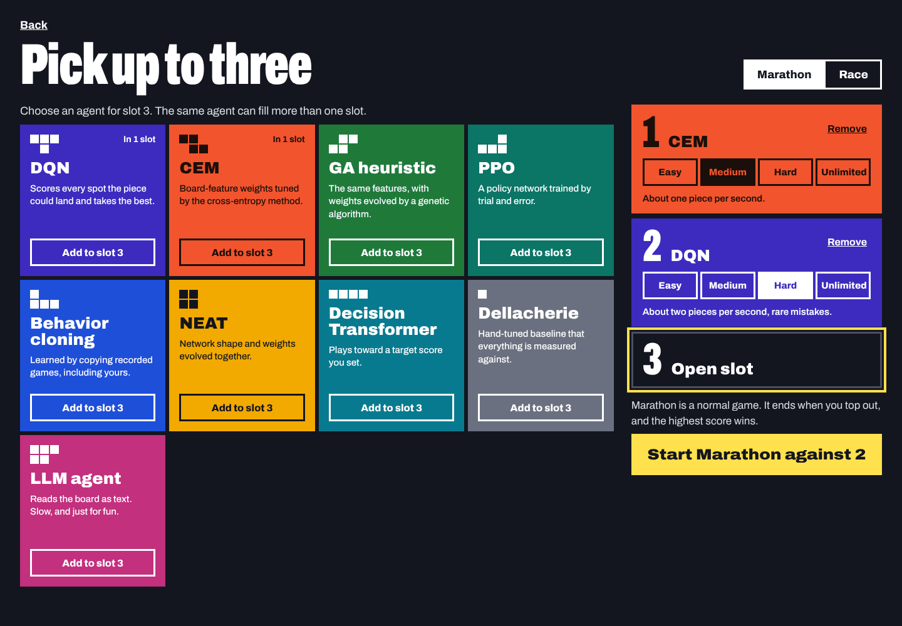 |
| Marathon match | 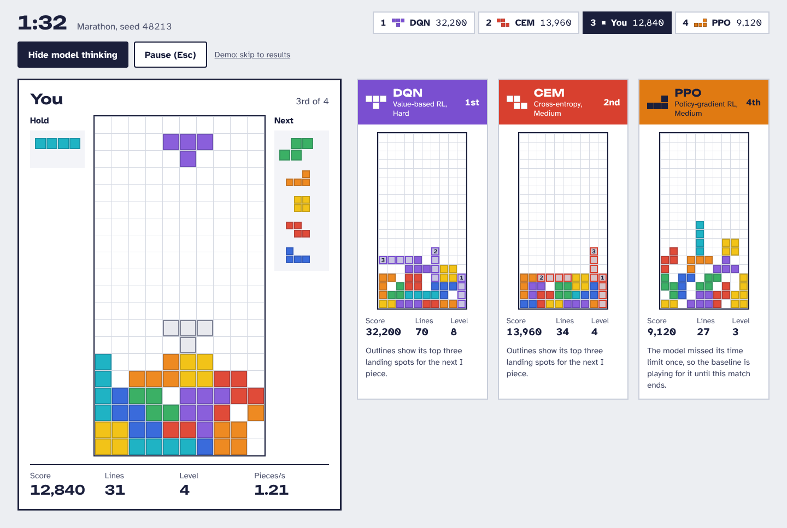 |  |  |  |
| Results | 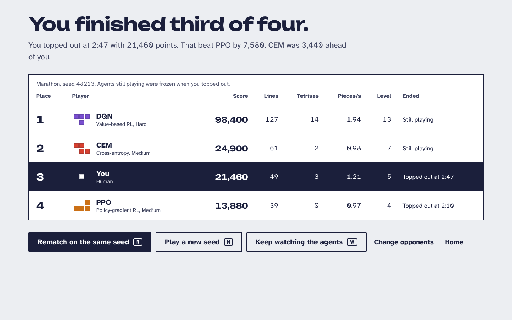 |  |  | 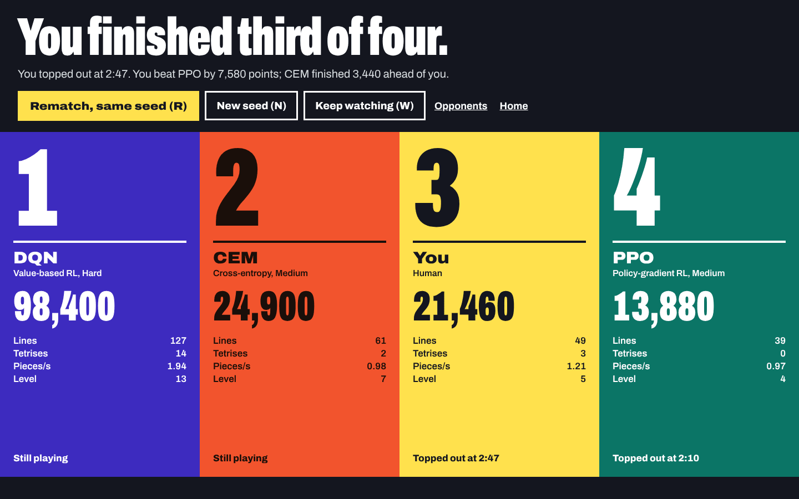 |
| Leaderboard | 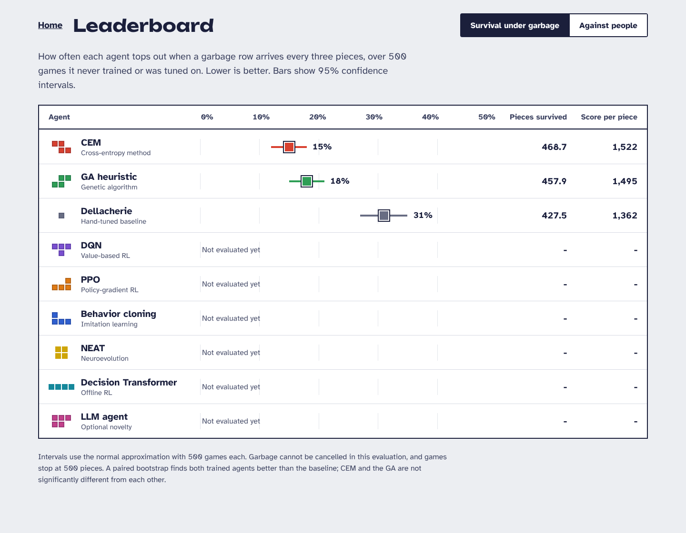 | 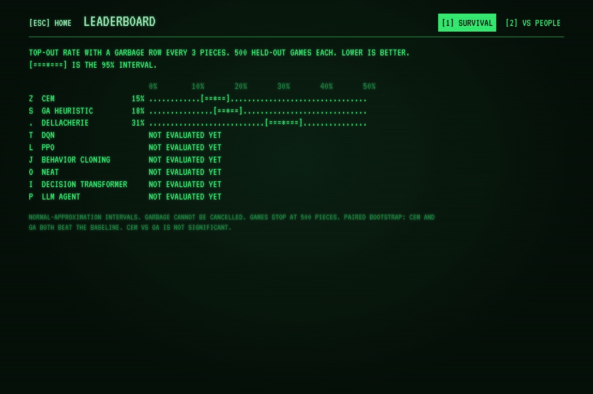 |  | 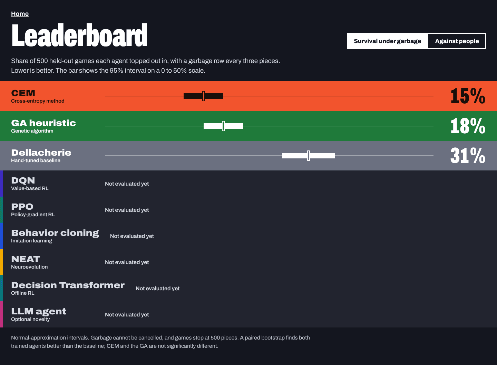 |

The look switcher on every Home screen links between looks.

## Architecture

- **Server:** FastAPI and uvicorn in `tetris/web/`. It wraps the existing
  `MatchController` and agent worker pool. Game logic stays on the server and
  is authoritative; the browser reimplements no game rules.
- **Transport:** one WebSocket per client.
  - The client sends input events (key down and key up with timestamps).
    DAS, ARR and soft drop stay in the Python input layer.
  - The server streams snapshots at 60 Hz in a compact encoding: a board is
    a 200-character string, plus the active piece, ghost, hold, next queue
    and stats.
  - Message size and input-to-render latency (p50 and p99) are measured on
    localhost.
- **REST endpoints:** agents and their checkpoints, settings, leaderboard
  data, match history, and starting or ending a match.
- **Frontend:** TypeScript, Vite and React, built into static files that
  FastAPI serves.
  - Boards are drawn on `<canvas>`, for 60 fps with four boards on screen.
  - Menus, panels, tables and charts are DOM, so they get real buttons,
    links, focus states and screen reader support.
- **The Pygame app keeps working.** It is the fallback if the browser path
  fails during a demo.

## Additions to the match layer

1. **Event feed.** `MatchController` emits typed events: line clear (with
   count), Tetris, back-to-back, lead change, top-out, agent fallback to the
   baseline (with the reason), and match end. They go out over the
   WebSocket; Broadcast's ticker and the results screen use them.
2. **Model thinking.** Each agent worker returns its top 3 candidate
   placements with ranks along with its chosen placement.
   - Value-based and heuristic agents rank by value.
   - PPO and behavior cloning rank by policy probability.
   - The Decision Transformer ranks by action logits.
   - The LLM agent and any agent in fallback return none.
   - The candidates are in the snapshot, so the client draws them as
     numbered outlines. A "Show model thinking" toggle hides them; it
     defaults to on.
3. **History.** Each Marathon result (seed, opponents and difficulties,
   every player's final stats) is stored in a local file. The opponent and
   leaderboard screens show "Your record" per agent and difficulty. A win
   means the human's score beat that agent's score.

## Theme system

- One set of screens and components. A theme supplies:
  - design tokens: colors, fonts, spacing, borders and radii;
  - a board renderer (a canvas drawing function);
  - layout variants where the mockups differ structurally.
- A theme registry with ids `tetromino`, `terminal`, `broadcast` and
  `poster`. Adding a theme means adding one folder.
- The look switcher appears on every Home screen and in Settings. The choice
  persists in localStorage and in the server settings file, and switching
  takes effect immediately, including mid-match.
- **Fonts are self-hosted** as woff2 files in the repository. All four
  families are under the SIL Open Font License, and the license files ship
  with them. There are no CDN or Google Fonts requests at runtime.

### Agent identity (shared by every theme)

Each agent is a piece. Shapes: T, Z, S, L, J and O are the standard
tetrominoes; I is four in a row; "mono" is a single block; "P" is the P
pentomino (XXX over XX.).

| Agent | Piece | A color / header text | C color | D field / text | B letter |
|---|---|---|---|---|---|
| DQN | T | #7A4FD0 / white | #B07CFF | #3D2BBF / #FFFFFF | T |
| CEM | Z | #D53E2D / white | #FF5A5A | #F2542D / #1A0F0A | Z |
| GA heuristic | S | #2E9E55 / ink | #4BE08A | #1F7A3A / #FFFFFF | S |
| PPO | L | #E07A12 / ink | #FF9B3D | #0B7566 / #FFFFFF | L |
| Behavior cloning | J | #2F5FD0 / white | #5B8CFF | #1E4FD8 / #FFFFFF | J |
| BC (you) | J | #729410 / ink | #C6F24E | #A4CC1C / #14161F | j |
| NEAT | O | #E6B800 / ink | #FFD23F | #F2A900 / #14161F | O |
| Decision Transformer | I | #1597A8 / ink | #22D3E6 | #087A8F / #FFFFFF | I |
| Dellacherie (baseline) | mono | #6B7080 / white | #AEB4C8 | #6B7080 / #FFFFFF | . |
| LLM agent (optional) | P | #C2408A / white | #FF7AC6 | #C2307E / #FFFFFF | P |
| Human | none | ink #1B1F3B | coral #FF5A3C | #FFE14D / #14161F | @ |

Variants reuse their parent's piece and colors: PPO (raw actions) as PPO
with B letter `l`, and BC (pure) and BC + DAgger as Behavior cloning with B
letter `J`. PPO (raw actions) is listed under "Variants" on the opponent
screen and is not on Home; BC (pure) and BC + DAgger appear on the
leaderboard only. Every A header color pair meets 4.5:1: CEM's fill was
#D8402F (white text 4.47:1), and GA and the Decision Transformer use ink
text because white is about 3.4:1 on their fills.

The identity is defined once in a shared module, not per theme.

### A. Tetromino

- **Colors:** background #ECEEF2; ink #1B1F3B; secondary text #3E4462 and
  #4D5370; panels #FFFFFF; borders #C9CEDA; board gaps #D6DAE3.
- **Board pieces:** I #1FB3C4, O #F2C318, T #8A5FDB, S #3BB065, Z #E04B39,
  J #3A6BDB, L #EE8A22. Flat fills with a 2px inner ink border at 20%
  opacity. Empty cells are white.
- **Fonts:** Unbounded 600/700 for headings and big numbers; Atkinson
  Hyperlegible 400/700 for everything else, with tabular figures.
- **Shape:** square panels and 4px radius buttons. The human board has a
  3px ink border. Agent card headers are filled with the agent color, with
  the header text color from the identity table.
- **Model thinking:** candidate outlines in the agent's color with a 15%
  fill, and the rank number in the first cell.
- **Leaderboard:** a confidence-interval chart. Each row has a dot for the
  estimate and a bar for the 95% interval, in the agent color, on a 0 to 50%
  scale.

### B. Terminal 1984 (homage to the Elektronika 60 original)

- **Colors:** background #06110A with a radial glow to #0C2414; text
  #39FF7A; bright #B8FFD0; dim #1F8A45; text glow
  `0 0 6px rgba(57,255,122,0.45)`. A scanline overlay is a repeating 1px
  dark line every 3px.
- **Font:** VT323 everywhere.
- **Boards are text:**
  - a filled cell is `[]` and an empty cell is ` .`;
  - the ghost is `::`;
  - walls are `<!` and `!>`, with a `<!====...!>` floor and a `\/\/\/...`
    base row;
  - model-thinking candidates are `()`, with the first cell showing the rank
    as `1)`, `2)` or `3)`.

  The renderer draws characters, not colored cells.
- **Home** is a numbered keyboard menu: keys 1 to 7 select, Enter starts
  Marathon, and the selected row is shown in reverse video.
- **Results and Leaderboard** are fixed-width tables. The
  confidence-interval chart is ASCII: `.` for the track, `[` and `]` for the
  interval ends, `=` inside it, and `*` for the estimate.
- The blinking cursor stops when `prefers-reduced-motion` is set.

### C. Broadcast (esports stream)

- **Colors:** background #1F2FBF; deep panels #121C80; board wells #16207A
  and #0C1458; text #FFFFFF and #DCE1FF; coral #FF5A3C for the human; yellow
  #FFD23F for the leader, the active toggle and the candidate outlines.
- **Board pieces:** I #22D3E6, O #FFD23F, T #B07CFF, S #4BE08A, Z #FF5A5A,
  J #5B8CFF, L #FF9B3D.
- **Fonts:** Barlow Condensed (italic 800/900) for names, scores and
  headings; Barlow 500/700 for body text.
- **Shape language:** plates, tabs and buttons are skewed with
  `skewX(-12deg)`, and their contents are counter-skewed so the text stays
  upright.
- **Match screen:**
  - a score bar across the top, sorted by rank, with the leader's plate in
    yellow and the human's in coral;
  - a name banner overlapping the bottom of each board;
  - a "Live" ticker along the bottom, fed by the event feed, in plain words
    ("CEM moves into 2nd, 1,120 ahead of you").
- **Home** shows a "Survival eval" ticker built from the leaderboard data.

### D. Color-field poster

- **Colors:** background #14161F; each player is a full-height column
  filled with their D field color.
- **Font:** Archivo (variable width): width 62% for huge numerals (ranks at
  about 168px, scores at 52 to 72px) and 112% for names.
- **Boards are one color:** filled cells in the column's text color; empty
  cells as faint grid lines in that color at 14%; the ghost as an outline at
  55%; candidates as dashed outlines.
- **Match and Results:** the human's column is yellow and twice as wide as
  the others.
- **Home:** vertical agent stripes with the names rotated.
- **Leaderboard:** one horizontal band per agent with a large top-out
  percentage. Agents not evaluated yet get grey bands with a strip of their
  color on the left edge.

## Screens (all four looks)

1. **Home:** headline, two start buttons (Marathon, Race), the agent lineup,
   other modes (Watch AI, Solo practice, Record your games, Leaderboard), the
   look switcher and a controls legend.
2. **Choose opponents:**
   - a Marathon/Race toggle;
   - an agent list showing piece, name, family, one-line description and
     "Your record";
   - 3 slots, each with a difficulty selector (Easy, Medium, Hard,
     Unlimited) and a one-line description of that difficulty. Duplicate
     agents are allowed.
   - Only agents that have checkpoints are listed, and the last selection is
     remembered.
   - The start button says what will happen ("Start Marathon against 3
     agents").
3. **Match:**
   - timer and live standings;
   - the human board with hold, a 5-piece next queue and stats (score,
     lines, level, pieces per second);
   - one board per agent with name, family, difficulty, place, score, lines,
     level and a status line;
   - the model-thinking toggle, and Pause (Esc).
   - When an agent falls back to the baseline, its board says so in plain
     words.
   - Race mode uses the same screen with its timer and win condition.
4. **Results:**
   - a plain-sentence headline ("You finished third of four.") and a
     one-line summary of the score gaps;
   - a table of place, player, score, lines, Tetrises, pieces per second,
     level and how each game ended;
   - actions: Rematch on the same seed (R), New seed (N), Keep watching the
     agents (W), Change opponents, Home.
5. **Leaderboard:**
   - **Survival:** top-out rate with 95% Wilson score intervals, plus pieces
     survived and score per piece, with a short note on the method that
     includes the paired bootstrap result. Agents not yet evaluated show
     "Not evaluated yet".
   - **Against people:** the Marathon evaluation per difficulty, plus your
     record against each agent.
6. **Not mocked up, built in each look from the same components:** Watch AI
   (one agent, with the top-3 overlay always available), Solo practice,
   Record your games, and Settings (look, key rebinding, DAS, ARR, soft drop
   speed, ghost piece).

The UI never invents numbers: any value not yet computed shows as pending.
Leaderboard results are read with the checkpoint that produced them
(`reports/leaderboard/leaderboard_sources.json`). A result from a checkpoint
marked buggy (such as `*mpsbug*`), from a checkpoint that has since changed,
or with no recorded source shows as "Pending rerun" instead of its numbers.

## Quality bar

- **Projector:**
  - Tested at 1920x1080 and 1280x720.
  - Body text at least 18px. Scores and timers large enough to read from
    the back of a classroom.
  - All text meets 4.5:1 contrast, or 3:1 for 24px and larger.
- **Accessibility:**
  - Full keyboard navigation with a visible focus ring.
  - Real `<button>` and `<a>` elements, and `aria-pressed` or
    `aria-selected` on toggles and tabs.
  - Boards have `role="img"` with a label.
  - `prefers-reduced-motion` is respected.
- **Performance:** 60 fps with the human and three agents on Unlimited,
  measured as p50 and p99 browser frame time and input-to-render latency
  (`reports/ui/web_performance.md`).
- **Resilience:**
  - If the WebSocket drops, the match pauses, a plain banner says
    "Connection lost. Reconnecting..." and the match resumes on reconnect.
  - Agent fallbacks show on the board but never stop the match.
- **No emojis** anywhere in code, UI copy or docs.

## Demo mode and launch

- `python -m tetris.web` starts the server, builds the frontend if needed,
  and opens the browser. It works with no internet connection.
- `--demo` preselects opponents and a fixed seed, starts on a set look, and
  lets F9 skip to the results screen and F10 cycle through the four looks.
- `docs/demo_checklist.md` has the steps before class: run once while
  online, check the projector resolution, test fullscreen (F11), and know
  the Pygame fallback command.

## What changed in the build

- **Demo lineup:** the brief asked for CEM Medium, DQN Hard and PPO Medium.
  The lineup, look and seed now come from `configs/demo.yaml`, which sets
  BC (you) Medium, CEM Easy and PPO Medium on the Tetromino look.
- **A third leaderboard view:** Comparisons, the table of paired bootstrap
  differences between agents, next to Survival and Against people.
- **Screenshots:** the Playwright screenshot tests write every screen in
  every look to `web/screenshots/` (not in git) rather than `reports/ui/`.
  The README uses five of them, in `docs/screenshots/`.
- **LLM fallbacks:** the LLM agent's board also shows how many of its moves
  fell back to the GA heuristic, and why, in all four looks.
