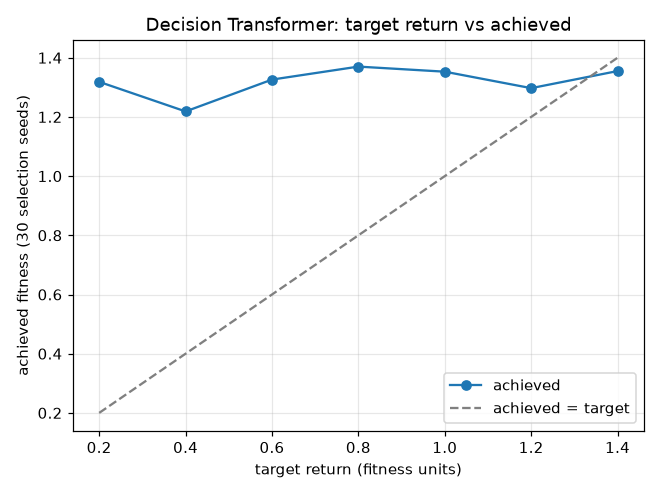

# Decision Transformer: target-return calibration

The model chooses actions by afterstate matching (each placement's logit is the match between the transformer's output and an embedding of that placement's afterstate) rather than with an 80-way action classifier. Raw-action PPO already shows the raw action space failing here: held-out fitness 0.103, against 1.280 to 1.345 for the seven top agents, all of which score afterstates.

The selected model played 30 selection seeds (garbage setting) at each target return. Returns are in fitness units: a game's return equals its fitness when it reaches the 500-piece cap.

| Target | Achieved fitness | Top-out rate | Mean pieces | Score/piece |
|---|---|---|---|---|
| 0.20 | 1.319 | 0.17 | 469 | 1525 |
| 0.40 | 1.219 | 0.37 | 434 | 1405 |
| 0.60 | 1.326 | 0.17 | 471 | 1533 |
| 0.80 | 1.370 | 0.10 | 487 | 1581 |
| 1.00 | 1.353 | 0.13 | 482 | 1557 |
| 1.20 | 1.297 | 0.17 | 462 | 1492 |
| 1.40 | 1.355 | 0.10 | 482 | 1567 |

Rank correlation between target and achieved fitness: +0.43 (+1 means a higher target always played better).

Default target (highest achieved fitness, used on the leaderboard): 0.80.

