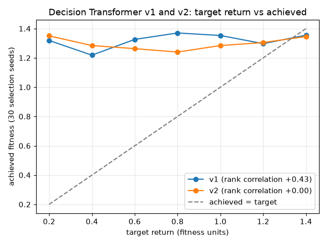

# Decision Transformer v2: does skill the board shows make the target return work?

DT v1's target return barely changed its play (rank correlation +0.43 between target and achieved fitness; asking for 0.2 still played at 1.32). Hypothesis: v1's weak games came from injected mistakes, which the board does not predict, so the model learned to imitate the strong placements and ignore the return-to-go. v2 keeps the model, training budget and selection protocol and changes only the data: no injected mistakes; instead each trained agent plays at three stages of its training (first evaluated checkpoint, the checkpoint with selection fitness closest to halfway, and the selected one), plus BC (you) and raw-action PPO.

## Data

v1: 995 games, 303,011 states.

| Source | Checkpoint | Mistake rate | Games | States | Mean return |
|---|---|---|---|---|---|
| dellacherie_noise0 | promoted | 0 | 45 | 19,345 | 1.201 |
| dellacherie_noise0.1 | promoted | 0.1 | 45 | 13,009 | 0.806 |
| dellacherie_noise0.3 | promoted | 0.3 | 45 | 4,722 | 0.279 |
| ga_noise0 | promoted | 0 | 45 | 20,724 | 1.298 |
| ga_noise0.1 | promoted | 0.1 | 45 | 14,910 | 0.931 |
| ga_noise0.3 | promoted | 0.3 | 45 | 5,324 | 0.320 |
| cem_noise0 | promoted | 0 | 45 | 20,926 | 1.306 |
| cem_noise0.1 | promoted | 0.1 | 45 | 17,318 | 1.083 |
| cem_noise0.3 | promoted | 0.3 | 45 | 4,955 | 0.295 |
| dqn_noise0 | promoted | 0 | 45 | 19,622 | 1.234 |
| dqn_noise0.1 | promoted | 0.1 | 45 | 15,672 | 0.984 |
| dqn_noise0.3 | promoted | 0.3 | 45 | 5,266 | 0.314 |
| ppo_noise0 | promoted | 0 | 45 | 21,159 | 1.331 |
| ppo_noise0.1 | promoted | 0.1 | 45 | 18,754 | 1.181 |
| ppo_noise0.3 | promoted | 0.3 | 45 | 12,572 | 0.786 |
| bc_pure_noise0 | promoted | 0 | 45 | 20,783 | 1.300 |
| bc_pure_noise0.1 | promoted | 0.1 | 45 | 18,063 | 1.132 |
| bc_pure_noise0.3 | promoted | 0.3 | 45 | 9,106 | 0.568 |
| neat_noise0 | promoted | 0 | 45 | 19,815 | 1.236 |
| neat_noise0.1 | promoted | 0.1 | 45 | 14,535 | 0.910 |
| neat_noise0.3 | promoted | 0.3 | 45 | 4,213 | 0.247 |
| ppo_raw_noise0 | promoted | 0 | 50 | 2,218 | 0.103 |

v2: 980 games, 287,323 states.

| Source | Checkpoint | Mistake rate | Games | States | Mean return |
|---|---|---|---|---|---|
| dqn_first | eval_0005min_259968.pt | 0 | 70 | 4,695 | 0.166 |
| dqn_mid | eval_0065min_3564608.pt | 0 | 70 | 18,484 | 0.753 |
| dqn_best | eval_0025min_1418880.pt | 0 | 70 | 33,760 | 1.365 |
| ppo_first | eval_0005min_114688.pt | 0 | 70 | 2,992 | 0.100 |
| ppo_mid | eval_0056min_1073152.pt | 0 | 70 | 21,778 | 0.868 |
| ppo_best | eval_0147min_2744320.pt | 0 | 70 | 32,650 | 1.321 |
| bc_first | eval_0003min_998.pt | 0 | 70 | 27,462 | 1.105 |
| bc_mid | eval_0006min_2030.pt | 0 | 70 | 30,882 | 1.244 |
| bc_best | eval_0021min_7252.pt | 0 | 70 | 33,055 | 1.331 |
| neat_first | gen_0000.json | 0 | 70 | 14,425 | 0.570 |
| neat_mid | gen_0200.json | 0 | 70 | 27,420 | 1.099 |
| neat_best | gen_0060.json | 0 | 70 | 32,468 | 1.302 |
| bc_you | promoted | 0 | 70 | 4,157 | 0.156 |
| ppo_raw | promoted | 0 | 70 | 3,095 | 0.103 |

## Selection (30 selection seeds, at each version's selection target)

| Version | Selection target | Checkpoints evaluated | Selection fitness range | Selected | Selection fitness |
|---|---|---|---|---|---|
| v1 | 1.417 | 12 | 1.255 to 1.374 | eval_0090min_7851.pt | 1.374 |
| v2 | 1.418 | 12 | 1.142 to 1.345 | eval_0050min_4057.pt | 1.345 |

Playable DT: **v1** (v2 only if its selection fitness is strictly higher; both were chosen on the selection seeds, so the held-out results below play no part in the choice).

## Calibration

Each version at each target on 30 selection seeds.

| Target | 0.20 | 0.40 | 0.60 | 0.80 | 1.00 | 1.20 | 1.40 |
|---|---|---|---|---|---|---|---|
| v1 achieved | 1.319 | 1.219 | 1.326 | 1.370 | 1.353 | 1.297 | 1.355 |
| v2 achieved | 1.350 | 1.284 | 1.263 | 1.240 | 1.284 | 1.304 | 1.346 |

| Version | Rank correlation (target, achieved) | Lowest achieved | Highest achieved | Default target |
|---|---|---|---|---|
| v1 | +0.43 | 1.219 | 1.370 | 0.80 |
| v2 | +0.00 | 1.240 | 1.350 | 0.20 |

## Held-out play (DT only)

Held-out seeds 900000..900499, each version at its default target. The other agents were not replayed; v2's rank is against their leaderboard results (`reports/leaderboard.md`).

| Setting | Version | Fitness | Top-out rate [95% Wilson] | Pieces survived | Lines/piece | Rank |
|---|---|---|---|---|---|---|
| garbage | v1 | 1.309 | 0.16 [0.13, 0.19] | 466.0 | 0.679 | (leaderboard row) |
| garbage | v2 | 1.220 | 0.30 [0.26, 0.34] | 434.7 | 0.667 | 8 of 11 |
| plain | v1 | 1.196 | 0.00 [0.00, 0.01] | 1000.0 | 0.399 | (leaderboard row) |
| plain | v2 | 1.196 | 0.00 [0.00, 0.01] | 1000.0 | 0.399 | 5 of 11 |

| Setting | v2 minus v1: fitness | v2 minus v1: top-out rate | v1 replay matches the leaderboard |
|---|---|---|---|
| garbage | -0.090 [-0.127, -0.054]* | +0.142 [+0.092, +0.192]* | yes |
| plain | -0.001 [-0.001, -0.000]* | +0.000 [+0.000, +0.000] | yes |

Paired bootstrap (10,000 resamples); intervals that exclude 0 are marked *.

## Marathon (100 games per preset, held-out seeds)

| Version | Preset | Score 1 min | Score 3 min | Score 5 min | Score 10 min | Cap-hit rate |
|---|---|---|---|---|---|---|
| v1 | Easy | 2,132 | 11,974 | 28,832 | 94,999 | 0.00 |
| v1 | Medium | 6,413 | 39,716 | 98,966 | 363,272 | 1.00 |
| v1 | Hard | 19,680 | 137,237 | 355,809 | 950,449 | 1.00 |
| v2 | Easy | 2,105 | 11,873 | 28,890 | 96,715 | 0.00 |
| v2 | Medium | 6,376 | 39,679 | 98,802 | 359,337 | 1.00 |
| v2 | Hard | 19,629 | 137,071 | 353,661 | 940,301 | 1.00 |

Runtime: 56 minutes.
